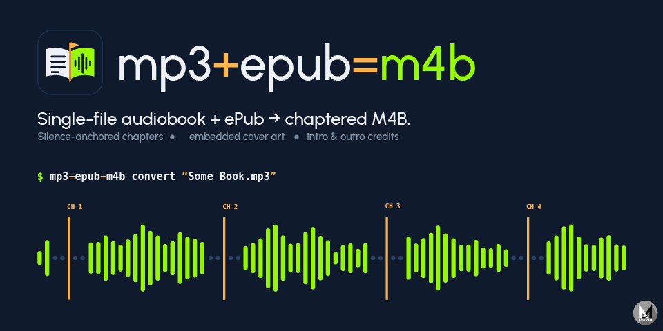

# mp3+epub=m4b

Turns a single-file audiobook (`.mp3` / `.m4a`) plus its EPUB into a chaptered
`.m4b` with accurate chapter boundaries, embedded cover art, and optionally the
opening/end credits split into their own chapters. The start and end of the book are found
and confirmed from what the narrator actually says, every chapter's length is checked
against its text, and you're asked when something doesn't fit — all before anything is
encoded, so a wrong boundary costs a minute instead of a full re-run.

## Requirements

- macOS with [Homebrew](https://brew.sh) *(the helper scripts and iCloud handling are macOS-only; the Python CLI itself only needs the tools below, so it should work anywhere they do)*
- [ffmpeg](https://ffmpeg.org) (with `ffprobe`)
- [uv](https://docs.astral.sh/uv/) and Python 3.12+
- Node 24+, only for the readaloud EPUB step (`--no-readaloud` skips it)
- [whisper.cpp](https://github.com/ggml-org/whisper.cpp) (`brew install whisper-cpp`) and a GGML
  model such as `ggml-base.en.bin` in `~/.cache/whisper-models`: needed by the default
  `--align-by anchored` (and by `transcribe`); `--align-by silence` works without it

## Setup

```shell
git clone https://github.com/maxludden/mp3-epub-m4b.git
cd mp3-epub-m4b
./setup.sh
```

`setup.sh` installs the requirements above via Homebrew if they're missing, the
readaloud aligner, and a Python venv at `~/.mp3-epub-m4b-venv` (override with
`MP3_EPUB_M4B_VENV`). It is safe to re-run. Without Homebrew, install the
requirements yourself and run `uv sync`.

To run `mp3-epub-m4b` from any directory, install it as a tool:

```shell
uv tool install .
```

(or use the `./convert.sh` / `./convert-batch.sh` wrappers, which call `uv run --project`).
The commands below assume it's on your `PATH`; inside the repo use `uv run mp3-epub-m4b`.

## Convert one book

```shell
mp3-epub-m4b convert "Volume 1.mp3" book_01.epub
mp3-epub-m4b convert "Some Book.mp3"      # uses "Some Book.epub" beside it
```

The EPUB argument is optional: without it, the `.epub` with the same name as the audio
file (in the same folder) is used.

The M4B lands in an `m4b/` folder next to the audio (or pass `-o DIR`). Expect roughly
30–40 minutes for a ~24 h book. The optional `./convert.sh` wrapper does the same and
turns on `--detect-intro --detect-outro`.

**Preview the chapters first.** `--dry-run` scans the audio, places the chapters and
prints the table without encoding anything, so a bad boundary shows up in minutes
instead of after the encode. A real run afterwards reuses the saved scan:

```text
$ mp3-epub-m4b convert "Volume 1.mp3" book_01.epub --dry-run
planning chapters for Volume 1.mp3 with book_01.epub (no encoding)
extracted: Fish & Chips: A Test by Ann Author, 3 chapters, cover=yes
scanning Volume 1.mp3 for silences
scan: found 5 silences
chapter 3: ignored 1 gap(s) earlier than 27s after the previous chapter (scene break?)
Chapters
┏━━━┳━━━━━━━━━━━━━━━━━┳━━━━━━━━━┳━━━━━━━━━┳━━━━━━━┳━━━━━━┓
┃ # ┃ Title           ┃   Start ┃  Length ┃ Words ┃ Note ┃
┡━━━╇━━━━━━━━━━━━━━━━━╇━━━━━━━━━╇━━━━━━━━━╇━━━━━━━╇━━━━━━┩
│ 1 │ First Light     │ 0:00:00 │ 0:00:32 │   302 │      │
│ 2 │ Tom & Jerry     │ 0:00:32 │ 0:01:11 │   603 │      │
│ 3 │ Fate = Doom; #3 │ 0:01:43 │ 0:00:45 │   404 │      │
└───┴─────────────────┴─────────┴─────────┴───────┴──────┘
                3 chapters, 0:02:28 total
```

Rows are highlighted when a chapter was placed with low confidence (no companion
gap), by fallback (no gap found), or when its length is far from what its word
count predicts.

After a real run the output is verified:

```text
Fish & Chips A Test.m4b: chapters: 3 | duration: 0:02:28 (source 0:02:28) | streams: 3
```

## How chapters are found

By default (`--align-by anchored`) the start and end of the book are pinned down before
any chapter is placed, and nothing is encoded until every chapter checks out:

1. The audio is split into clips at chapter-length silences.
2. The first 10 seconds of the first 5 and last 5 clips are transcribed with whisper.cpp.
3. Every part of the EPUB is read in order — front matter, parts, chapters, back matter.
4. **Start:** the opening clips are matched against the first sections until one lines up
   (say, Chapter 1). It is confirmed only if a following clip matches the *next* section
   (Chapter 2). Sections before it (title page, copyright…) count as not narrated.
5. **End:** the last clips are matched against the final sections in reverse order and
   confirmed against the section before. Back matter after it counts as not narrated.
6. Chapters in between are placed at silences, and each one's length is checked against
   its word count at the book's speaking rate. One more than 10% *and* 15 seconds off is
   flagged.

When a check fails, you're asked. You hear the 10-second clip, see what whisper heard and
the opening lines of the candidate sections, and pick where the narrator is. A flagged
chapter gets the same treatment at its suspect boundary, with "no chapter starts here" (a
pause inside a chapter) and "keep it as it is" options. A first or last chapter whose length
doesn't fit sends you back to the start or end question, since that anchor is the likely
culprit. Your answer fixes that boundary and everything after
it is re-checked.

Without a terminal (a batch run, Claude, a pipe) the question is saved instead, nothing is
encoded, and `convert` exits with status 3. Answer it later, and the conversion carries on
with its original settings:

```shell
mp3-epub-m4b resolve "Volume 1.mp3"
```

## Convert a whole series

```shell
mp3-epub-m4b batch "/path/to/series folder"
mp3-epub-m4b batch                          # the current directory
```

Files are paired in two ways, numbered pairs first:

1. **By number.** By default an audio file named `Volume N`, `Vol. N`, `VolN` or
   `N - Title` is paired with an EPUB ending in `_N` or containing `N - ` (e.g.
   `Volume 3.mp3` + `my_series_03.epub`). For other names use `--audio-pattern` (fully
   matched against the audio file's name) and `--epub-pattern` (searched in the EPUB's
   name). Each is a regex capturing the number; alternatives may each have their own group:

   ```shell
   mp3-epub-m4b batch ./series --audio-pattern 'Book (\d+)' --epub-pattern '_(\d+)$'
   ```

2. **By name.** Whatever is left is paired when the names match exactly (case-insensitive):
   `Some Book.mp3` (or `.m4a`) + `Some Book.epub`.

The pairs are then listed and you are asked to confirm. Pass `--yes` (`-y`) to skip the
question (needed when running unattended); `--dry-run` lists the pairs and the planned
chapters without asking or encoding.

Unmatched files are reported and skipped, and the batch stops if free disk space
drops below 8 GB. `./convert-batch.sh` is an optional wrapper.

A batch never stops to ask. A book that needs a decision is left waiting (nothing
encoded), the next book starts, and the summary lists a `mp3-epub-m4b resolve` command for
each waiting book (the batch then exits with status 3). `mp3-epub-m4b status` shows them
as "waiting for input".

## Options worth knowing

- `--dry-run` — print the chapter table only (see above).
- `--verify / --no-verify` — probe the finished M4B and report chapters, duration and
  streams (on by default; warns if the duration differs from the source).
- `--evict` — afterwards, evict the source audio from local disk. Only acts on files in
  iCloud Drive (macOS). Evicted sources are always downloaded first, automatically.
- `--detect-intro` / `--detect-outro` — split opening / end credits into their own
  chapters. Off by default: auto-detection can misfire, and a false positive shifts every
  later chapter, so check the result with `--dry-run`.
- `--align-by anchored|silence|transcribe|auto` — how chapters are placed. `anchored` (the
  default) confirms the start and end of the book by transcript, places chapters at silences
  between them, length-checks every chapter and asks when something doesn't fit (see "How
  chapters are found"). `silence` places chapters at silences only and never asks.
  `transcribe` transcribes a window around where each chapter should start and finds its
  opening words, for recordings with no pause between chapters (roughly 15 minutes for a
  20-hour book). `auto` tries silence first and switches to `transcribe` when silence looks
  unreliable. `anchored` and `transcribe` need whisper.cpp.
- `--whisper-model` — GGML model for `anchored`/`transcribe` (default: the first `ggml-*.en.bin` in
  `~/.cache/whisper-models` or `~/.cache/whisper.cpp`; also `MP3_EPUB_M4B_WHISPER_MODEL`).
- `--min-gap`, `--bitrate`, `--overwrite`, `--fresh` — see `--help`.
- `--readaloud / --no-readaloud` — after delivery, align the M4B with the EPUB into an
  EPUB 3 with Media Overlays (`<epub name> (aligned).epub`, needs Node 24+). It is slow.
  If alignment fails the M4B is kept and re-running resumes at the alignment.
  `--align-device` and `--align-language` tune it; `mp3-epub-m4b stalign AUDIO EPUB`
  runs only this step.

## Good to know

- **The EPUB is required.** It provides chapter titles, word counts for sanity-checking
  the cuts, metadata, and the cover.
- **Interruptions are fine.** Progress is checkpointed; re-running the same command
  resumes. Saved progress is tied to the files and options it was started with —
  changing them (for example `--min-gap`) stops with a clear message; use `--fresh`.
- **Where things go.** Scratch work lives in `~/.mp3-epub-m4b-work` (override with
  `--work-dir` or `MP3_EPUB_M4B_WORK`). Each book gets a debug log at
  `<work folder>/<book>/pipeline.log`; set `MP3_EPUB_M4B_LOG_LEVEL=DEBUG` (or `TRACE`) for
  more detail on the console. Logging uses [loguru](https://github.com/Delgan/loguru) and is
  silent when the package is imported as a library until you call
  `logger.enable("mp3_epub_m4b")`.
- The audio is scanned for silences once (cached), chapters are placed in memory, and the
  M4B is encoded in a single pass, so chapter joins are gapless.
- **Checking on a long run.** While a book converts, the progress bars show a line under
  them saying what is happening (for example, which stretch of audio is being listened to).
  From another terminal, `mp3-epub-m4b status` reports every book in the work folder:
  stage checklist, chapters placed, speed, time left and whether the process is still alive.
  Give it an audio file or a work folder for one book, and add `--watch` to keep it
  refreshing until nothing is running.

## Troubleshooting

**A chapter starts mid-word or mid-sentence.** Narrators often put a short "companion"
pause a few seconds after the real chapter gap, and a long pause inside a chapter (a scene
break) can look like a boundary. Run `--dry-run` and look for rows marked
`low-confidence`; try `--min-gap` (lower to catch shorter transitions, higher to ignore
scene breaks) with `--fresh`. If the credits at the start or end are the culprit, toggle
`--detect-intro` / `--detect-outro`.

**Chapters placed by guess, "ran out of audio", or many lengths far from the word counts.**
The recording may have no pause between chapters: some are joined by music, a spoken "Part 2
of 3", or nothing at all, so silence can't find them. The default `anchored` mode asks you
about each chapter whose length doesn't fit; when there are many, `--align-by transcribe
--fresh` places every chapter by its opening words instead. In the `--dry-run` table, rows noted
`unmatched` are chapters whose opening words were never heard: they are placed by
interpolation, so check them against the audio.

**"output is Ns but the source is Ms" / `verify: duration is ...`.** The encode and the
source should match within about 3 seconds. A larger difference usually means the encode
was cut short (disk full, interrupted copy). Re-run with `--fresh --overwrite`; if it
persists, check the source plays to the end.

**"N segment(s) deviate >30% from the word-count estimate."** A chapter is much longer or
shorter than its word count predicts, which suggests two chapters merged or one was
skipped. Check those rows in the `--dry-run` table against the audio before trusting the
output. A warning that the average chapter length is implausible means the EPUB probably
isn't the right one for this audio.

**Alignment fails ("ran out of audio", "would start at the very end", or a readaloud
error).** The EPUB has more chapters than the audio, or the two are different editions
(if the audio has no pause between chapters, see the entry above).
For a readaloud failure the M4B is already delivered; fix the cause (Node 24+, enough
disk) and re-run to resume at the alignment, or pass `--no-readaloud`.

**"waiting for input" / exit status 3.** The start or end of the book couldn't be
confirmed, or a chapter's length doesn't fit its text, and there was no terminal to ask in.
Run `mp3-epub-m4b resolve AUDIO` in a terminal to listen to the clip and pick; the
conversion then carries on. If the same book keeps asking about the start, its audio may
open with long credits or a preview: pick the section the narrator begins in, or use "None
of these" to hear the next clip.

**"no whisper model found" / "whisper.cpp not found".** The default mode transcribes a few
10-second clips. Install whisper.cpp (`brew install whisper-cpp`) and put a model such as
`ggml-base.en.bin` in `~/.cache/whisper-models` (or pass `--whisper-model`), or use
`--align-by silence`.

**"was made for different input/options".** Saved progress belongs to other files or
settings. Re-run with the original settings, or add `--fresh`.

## Layout

- `cli.py` — Typer CLI (`convert`, `batch`, `resolve`, `stalign`, `status`); `options.py` — shared option definitions;
  `converter.py` — runs one book with progress bars; `pairing.py` — matches audio to EPUBs
- `run.py` — the resumable pipeline (stages: extract, scan, align, assemble, deliver, readaloud)
- `state.py` — checkpoint types, fingerprint and persistence
- `chapters.py` — chapter placement from the silence scan, segments, chapter metadata
- `anchors.py` — anchored mode: clips, start/end matching and confirmation, placement between
  anchors, the ±10% / 15 s length check
- `questions.py` — questions for a person and applying their answers; `prompt.py` — asking in
  the terminal
- `transcribe.py` — transcript-based placement: opening-word matching and whisper.cpp windows
- `status.py` — progress record and the `status` report; `log.py` — logging and highlighting
- `epub_extract.py` — EPUB metadata, chapters, word counts and cover
- `ffmpeg_tools.py` — ffmpeg/ffprobe helpers (silence scan, probing)
- `report.py` — chapter table and output verification
- `icloud.py` — iCloud Drive download/evict (macOS)
- `align.py` — readaloud alignment wrapper

## Development

```shell
uv sync            # includes pytest, mypy, ruff
uv run pytest      # tests marked `ffmpeg` are skipped if ffmpeg isn't installed
uv run mypy src tests && uv run ruff check . && uv run ruff format --check .
```

CI runs the same checks (`.github/workflows/ci.yml`); `.pre-commit-config.yaml` runs them
locally. MIT licensed — see `LICENSE`.

## MCP server (use it from Claude)

`mp3-epub-m4b-mcp` is an [MCP](https://modelcontextprotocol.io) server over stdio. It exposes
`find_pairs`, `start_conversion`, `conversion_status`, `pending_question`, `answer_question`
and `verify_m4b`. Conversions run as detached background processes, so `start_conversion`
returns immediately and you poll `conversion_status`. When it reports `waiting_for_input`,
`pending_question` returns the question, what was heard, the choices and the clip's path,
and `answer_question` records the pick and restarts the conversion.

The Claude skill that drives these tools lives in
[`skill/audiobook-mp3-to-m4b/SKILL.md`](skill/audiobook-mp3-to-m4b/SKILL.md); upload it in
claude.ai → Settings → Skills to install or update it.

```bash
# Claude Code, available in every project:
claude mcp add -s user mp3-epub-m4b -- uv run --directory /path/to/mp3-epub-m4b mp3-epub-m4b-mcp
```

This repo also ships a project-scoped `.mcp.json`.
