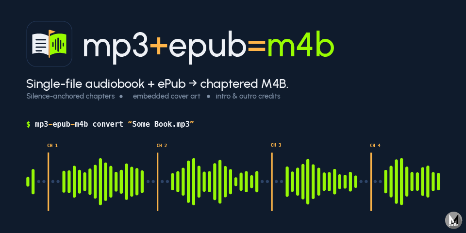

# mp3+epub=m4b

Turns a single-file audiobook (`.mp3` / `.m4a`) plus its EPUB into a chaptered
`.m4b` with accurate chapter boundaries (found from silence gaps in the audio or, when
chapters aren't separated by a pause, from where each chapter's opening words are spoken;
anchored chapter-by-chapter so they can't drift), embedded cover art, and optionally the
opening/end credits split into their own chapters.

## Requirements

- macOS with [Homebrew](https://brew.sh) *(the helper scripts and iCloud handling are macOS-only; the Python CLI itself only needs the tools below, so it should work anywhere they do)*
- [ffmpeg](https://ffmpeg.org) (with `ffprobe`)
- [uv](https://docs.astral.sh/uv/) and Python 3.12+
- Node 24+, only for the readaloud EPUB step (`--no-readaloud` skips it)
- [whisper.cpp](https://github.com/ggml-org/whisper.cpp) (`brew install whisper-cpp`) and a GGML
  model such as `ggml-base.en.bin`, optional: only for recordings with no pause between
  chapters (`--align-by transcribe`)

## Setup

```shell
git clone https://github.com/maxludden/mp3-epub-m4b.git
cd mp3-epub-m4b
./setup.sh
```

`setup.sh` installs the requirements above via Homebrew if they're missing, the
readaloud aligner, and a Python venv at `~/.mp3-epub-m4b-venv` (override with
`MP3_EPUB_M4B_VENV`). It is safe to re-run. Without Homebrew, install the
requirements yourself and run `uv sync`.

To run `mp3-epub-m4b` from any directory, install it as a tool:

```shell
uv tool install .
```

(or use the `./convert.sh` / `./convert-batch.sh` wrappers, which call `uv run --project`).
The commands below assume it's on your `PATH`; inside the repo use `uv run mp3-epub-m4b`.

## Convert one book

```shell
mp3-epub-m4b convert "Volume 1.mp3" book_01.epub
mp3-epub-m4b convert "Some Book.mp3"      # uses "Some Book.epub" beside it
```

The EPUB argument is optional: without it, the `.epub` with the same name as the audio
file (in the same folder) is used.

The M4B lands in an `m4b/` folder next to the audio (or pass `-o DIR`). Expect roughly
30–40 minutes for a ~24 h book. The optional `./convert.sh` wrapper does the same and
turns on `--detect-intro --detect-outro`.

**Preview the chapters first.** `--dry-run` scans the audio, places the chapters and
prints the table without encoding anything, so a bad boundary shows up in minutes
instead of after the encode. A real run afterwards reuses the saved scan:

```text
$ mp3-epub-m4b convert "Volume 1.mp3" book_01.epub --dry-run
planning chapters for Volume 1.mp3 with book_01.epub (no encoding)
extracted: Fish & Chips: A Test by Ann Author, 3 chapters, cover=yes
scanning Volume 1.mp3 for silences
scan: found 5 silences
chapter 3: ignored 1 gap(s) earlier than 27s after the previous chapter (scene break?)
Chapters
┏━━━┳━━━━━━━━━━━━━━━━━┳━━━━━━━━━┳━━━━━━━━━┳━━━━━━━┳━━━━━━┓
┃ # ┃ Title           ┃   Start ┃  Length ┃ Words ┃ Note ┃
┡━━━╇━━━━━━━━━━━━━━━━━╇━━━━━━━━━╇━━━━━━━━━╇━━━━━━━╇━━━━━━┩
│ 1 │ First Light     │ 0:00:00 │ 0:00:32 │   302 │      │
│ 2 │ Tom & Jerry     │ 0:00:32 │ 0:01:11 │   603 │      │
│ 3 │ Fate = Doom; #3 │ 0:01:43 │ 0:00:45 │   404 │      │
└───┴─────────────────┴─────────┴─────────┴───────┴──────┘
                3 chapters, 0:02:28 total
```

Rows are highlighted when a chapter was placed with low confidence (no companion
gap), by fallback (no gap found), or when its length is far from what its word
count predicts.

After a real run the output is verified:

```text
Fish & Chips A Test.m4b: chapters: 3 | duration: 0:02:28 (source 0:02:28) | streams: 3
```

## Convert a whole series

```shell
mp3-epub-m4b batch "/path/to/series folder"
mp3-epub-m4b batch                          # the current directory
```

Files are paired in two ways, numbered pairs first:

1. **By number.** By default an audio file named `Volume N`, `Vol. N`, `VolN` or
   `N - Title` is paired with an EPUB ending in `_N` or containing `N - ` (e.g.
   `Volume 3.mp3` + `my_series_03.epub`). For other names use `--audio-pattern` (fully
   matched against the audio file's name) and `--epub-pattern` (searched in the EPUB's
   name). Each is a regex capturing the number; alternatives may each have their own group:

   ```shell
   mp3-epub-m4b batch ./series --audio-pattern 'Book (\d+)' --epub-pattern '_(\d+)$'
   ```

2. **By name.** Whatever is left is paired when the names match exactly (case-insensitive):
   `Some Book.mp3` (or `.m4a`) + `Some Book.epub`.

The pairs are then listed and you are asked to confirm. Pass `--yes` (`-y`) to skip the
question (needed when running unattended); `--dry-run` lists the pairs and the planned
chapters without asking or encoding.

Unmatched files are reported and skipped, and the batch stops if free disk space
drops below 8 GB. `./convert-batch.sh` is an optional wrapper.

## Options worth knowing

- `--dry-run` — print the chapter table only (see above).
- `--verify / --no-verify` — probe the finished M4B and report chapters, duration and
  streams (on by default; warns if the duration differs from the source).
- `--evict` — afterwards, evict the source audio from local disk. Only acts on files in
  iCloud Drive (macOS). Evicted sources are always downloaded first, automatically.
- `--detect-intro` / `--detect-outro` — split opening / end credits into their own
  chapters. Off by default: auto-detection can misfire, and a false positive shifts every
  later chapter, so check the result with `--dry-run`.
- `--align-by auto|silence|transcribe` — how chapters are placed. `auto` (the default) tries
  silence first and switches to `transcribe` when silence fails or looks unreliable (chapters
  placed by guess, or many far from the length their word count predicts). `transcribe`
  listens instead: it transcribes a window around where each chapter should start and finds
  the chapter's opening words (epigraph included) in it, so it works when nothing separates
  chapters. It needs whisper.cpp and takes roughly 15 minutes for a 20-hour book. `silence`
  never transcribes. Without whisper.cpp, `auto` behaves exactly like `silence`.
- `--whisper-model` — GGML model for `transcribe` (default: the first `ggml-*.en.bin` in
  `~/.cache/whisper-models` or `~/.cache/whisper.cpp`; also `MP3_EPUB_M4B_WHISPER_MODEL`).
- `--min-gap`, `--bitrate`, `--overwrite`, `--fresh` — see `--help`.
- `--readaloud / --no-readaloud` — after delivery, align the M4B with the EPUB into an
  EPUB 3 with Media Overlays (`<epub name> (aligned).epub`, needs Node 24+). It is slow.
  If alignment fails the M4B is kept and re-running resumes at the alignment.
  `--align-device` and `--align-language` tune it; `mp3-epub-m4b stalign AUDIO EPUB`
  runs only this step.

## Good to know

- **The EPUB is required.** It provides chapter titles, word counts for sanity-checking
  the cuts, metadata, and the cover.
- **Interruptions are fine.** Progress is checkpointed; re-running the same command
  resumes. Saved progress is tied to the files and options it was started with —
  changing them (for example `--min-gap`) stops with a clear message; use `--fresh`.
- **Where things go.** Scratch work lives in `~/.mp3-epub-m4b-work` (override with
  `--work-dir` or `MP3_EPUB_M4B_WORK`). Each book gets a debug log at
  `<work folder>/<book>/pipeline.log`; set `MP3_EPUB_M4B_LOG_LEVEL=DEBUG` (or `TRACE`) for
  more detail on the console. Logging uses [loguru](https://github.com/Delgan/loguru) and is
  silent when the package is imported as a library until you call
  `logger.enable("mp3_epub_m4b")`.
- The audio is scanned for silences once (cached), chapters are placed in memory, and the
  M4B is encoded in a single pass, so chapter joins are gapless.
- **Checking on a long run.** While a book converts, the progress bars show a line under
  them saying what is happening (for example, which stretch of audio is being listened to).
  From another terminal, `mp3-epub-m4b status` reports every book in the work folder:
  stage checklist, chapters placed, speed, time left and whether the process is still alive.
  Give it an audio file or a work folder for one book, and add `--watch` to keep it
  refreshing until nothing is running.

## Troubleshooting

**A chapter starts mid-word or mid-sentence.** Narrators often put a short "companion"
pause a few seconds after the real chapter gap, and a long pause inside a chapter (a scene
break) can look like a boundary. Run `--dry-run` and look for rows marked
`low-confidence`; try `--min-gap` (lower to catch shorter transitions, higher to ignore
scene breaks) with `--fresh`. If the credits at the start or end are the culprit, toggle
`--detect-intro` / `--detect-outro`.

**Chapters placed by guess, "ran out of audio", or many lengths far from the word counts.**
The recording may have no pause between chapters: some are joined by music, a spoken "Part 2
of 3", or nothing at all, so silence can't find them. With whisper.cpp installed,
`--align-by auto` (the default) notices and switches to transcript placement by itself; you
can also force it with `--align-by transcribe --fresh`. In the `--dry-run` table, rows noted
`unmatched` are chapters whose opening words were never heard: they are placed by
interpolation, so check them against the audio.

**"output is Ns but the source is Ms" / `verify: duration is ...`.** The encode and the
source should match within about 3 seconds. A larger difference usually means the encode
was cut short (disk full, interrupted copy). Re-run with `--fresh --overwrite`; if it
persists, check the source plays to the end.

**"N segment(s) deviate >30% from the word-count estimate."** A chapter is much longer or
shorter than its word count predicts, which suggests two chapters merged or one was
skipped. Check those rows in the `--dry-run` table against the audio before trusting the
output. A warning that the average chapter length is implausible means the EPUB probably
isn't the right one for this audio.

**Alignment fails ("ran out of audio", "would start at the very end", or a readaloud
error).** The EPUB has more chapters than the audio, or the two are different editions
(if the audio has no pause between chapters, see the entry above).
For a readaloud failure the M4B is already delivered; fix the cause (Node 24+, enough
disk) and re-run to resume at the alignment, or pass `--no-readaloud`.

**"was made for different input/options".** Saved progress belongs to other files or
settings. Re-run with the original settings, or add `--fresh`.

## Layout

- `cli.py` — Typer CLI (`convert`, `batch`, `stalign`, `status`); `options.py` — shared option definitions;
  `converter.py` — runs one book with progress bars; `pairing.py` — matches audio to EPUBs
- `run.py` — the resumable pipeline (stages: extract, scan, align, assemble, deliver, readaloud)
- `state.py` — checkpoint types, fingerprint and persistence
- `chapters.py` — chapter placement from the silence scan, segments, chapter metadata
- `transcribe.py` — transcript-based placement: opening-word matching and whisper.cpp windows
- `status.py` — progress record and the `status` report; `log.py` — logging and highlighting
- `epub_extract.py` — EPUB metadata, chapters, word counts and cover
- `ffmpeg_tools.py` — ffmpeg/ffprobe helpers (silence scan, probing)
- `report.py` — chapter table and output verification
- `icloud.py` — iCloud Drive download/evict (macOS)
- `align.py` — readaloud alignment wrapper

## Development

```shell
uv sync            # includes pytest, mypy, ruff
uv run pytest      # tests marked `ffmpeg` are skipped if ffmpeg isn't installed
uv run mypy src tests && uv run ruff check . && uv run ruff format --check .
```

CI runs the same checks (`.github/workflows/ci.yml`); `.pre-commit-config.yaml` runs them
locally. MIT licensed — see `LICENSE`.

## MCP server (use it from Claude)

`mp3-epub-m4b-mcp` is an [MCP](https://modelcontextprotocol.io) server over stdio. It exposes
`find_pairs`, `start_conversion`, `conversion_status` and `verify_m4b`. Conversions run as
detached background processes, so `start_conversion` returns immediately and you poll
`conversion_status`.

```bash
# Claude Code, available in every project:
claude mcp add -s user mp3-epub-m4b -- uv run --directory /path/to/mp3-epub-m4b mp3-epub-m4b-mcp
```

This repo also ships a project-scoped `.mcp.json`.
