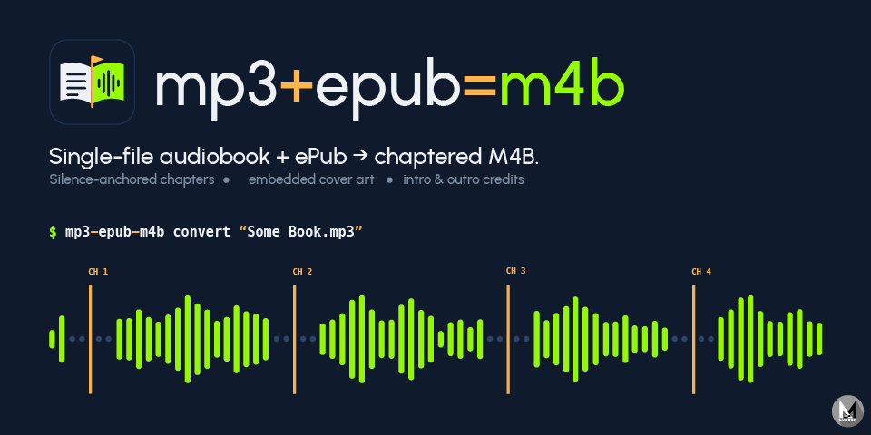

# mp3+epub=m4b

Turns a single-file audiobook (`.mp3` / `.m4a`) plus its EPUB into a chaptered
`.m4b` with accurate chapter boundaries, embedded cover art, and optionally the
opening/end credits split into their own chapters. The start and end of the book are
found and confirmed from what the narrator says, every chapter is length-checked against
its text, and you're asked when something doesn't fit — before anything is encoded.

## Quick start

```shell
uv tool install .
mp3-epub-m4b convert "Some Book.mp3"   # uses "Some Book.epub" beside it
mp3-epub-m4b batch "/path/to/series folder"
```

See [Installation](installation.md) to get set up, then [Convert one book](convert.md) or [Convert a series](batch.md).

<div align="center">
    <br />
    <a href="https://github.com/maxludden" style="text-decoration:none; color:inherit;">
        
    </a>
    <a href="https://github.com/maxludden" style="text-decoration:none; color:inherit;">
        <p>Designed by Max Ludden</p>
    </a>
</div>
